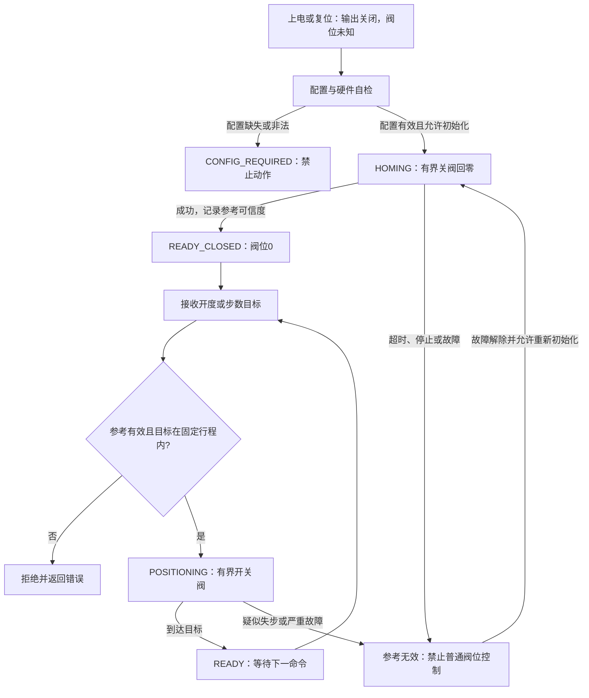

# ESP32-S31 电子膨胀阀控制模块设计文档（兼容单极/双极爪极定子）

版本：V0.7，方案评审稿（仅Markdown交付）  
日期：2026-10-14  
更新时间：2026-10-14 02:02:57 UTC  
用途：电子膨胀阀控制需求、硬件选型、原理图设计输入、固件架构与样机验收。

## 1. 已确认需求与设计结论

被控对象修正为**电子膨胀阀**：线圈/定子为爪极式步进电机结构，阀内转子及传动机构驱动阀芯，形成固定有效行程。模块兼容单极与双极定子，保留已确认的4线两相电气参数。用户已确认：**同一块板兼容，每次仅连接并驱动一种电机**。设计要求两类功率级均安装，采用单运动实例与硬件互斥使能，不要求双轴并行。

| 项目 | 已确认需求 / 设计基线 |
|---|---|
| 执行器 | 固定行程电子膨胀阀，爪极式步进定子；兼容单极/双极电气接法 |
| 阀位功能 | 零位设定、步数控制、百分比开度、上电自动初始化/回零、正转与反转 |
| 行程 | 保留手动全行程配置；初始化闭端参考后，自动识别闭/开端并测量有效总步数 |
| 行程来源 | AUTO自动识别或MANUAL手动设定；独立记录测量值、置信度与配置版本 |
| 零位检测 | 无零位传感器，模块侧实施无传感器全关参考识别，必须区分中途卡滞 |
| 堵转 | 模块侧堵转检测、锁存报警及网页/CAN FD/LIN/UART/USB上报 |
| 相电流 | 已知双极电机260 mA，额定定义待核对；单极电机独立配置，不沿用此数值 |
| 相电阻 | 已知双极电机24.3 Ω/相，待实测；单极电机待提供 |
| 输入 | 9–24 V DC |
| 控制 | 恒流；网页选择整步、半步及4/8/16/32/64/128/256细分，按实际驱动能力启用 |
| 主控 | ESP32-S31，用户已确认；具体模块封装、资源及SDK支持需按官方资料核对 |
| CAN | 必须支持CAN FD；与LIN、UART优先集中在同一独立通信芯片 |
| LIN | 从节点 |
| 其他接口 | UART、USB |
| 软件 | MicroPython优先；Wi-Fi网页控制与可视化；硬实时采用原生模块 |
| 升级 | 通过Wi-Fi访问设备网页并上传固件，支持OTA、进度反馈及失败恢复 |
| 驱动 | 优先采用专用步进控制芯片 |

**推荐基线：ESP32-S31作为Wi-Fi/网页/MicroPython应用主控；一颗独立通信MCU集中处理CAN FD、LIN和UART；双极与单极使用各自匹配的恒流功率级。** 通信MCU首选评估STM32G0B1系列，具体料号、封装、FDCAN资源和LIN-UART能力按官方资料冻结。CAN FD与LIN物理收发器仍需外接。

TMC2240为首选评估对象，原因是支持双极恒流、256微步及SPI配置，工作电压范围候选覆盖9–24 V并比低耐压方案留有更多余量。必须核对最新数据手册、实际低电流调节精度、采样配置和PCB温升后才能冻结BOM。备选为DRV8462类高耐压、支持256细分及SPI的驱动器；两者需要不同原生驱动和寄存器配置，不是同封装替换。

MicroPython负责网页业务、统一命令路由与参数管理。CAN FD、LIN、外部UART由通信MCU固件处理；ESP32原生模块负责运动与主控间链路。双极驱动芯片负责电流波形与恒流；单极方案由硬件恒流电路配合原生参考波形更新实现。纯Python定时或浏览器逐步发包不能作为稳定细分运动的保证。

> 本文为设计方案，不是已验证的生产原理图或可直接烧录的完整固件。电机电感、步距角、目标转速、环境及ESP32-S31具体资源/SDK尚未核实，因此不承诺最大转速、定位精度和认证结果。

### 1.1 主控型号与资源核对边界

主控型号已按用户要求确定为**ESP32-S31**，不再将其解释为ESP32-S3。本文尚未取得并核验该型号官方数据手册、模块资料和SDK目标，因此不会把其他ESP32型号的USB管脚、SPI实例、内存、无线能力或OTA安全特性直接视为ESP32-S31的已确认能力。

工程开工核对项：Wi-Fi AP/STA支持、USB实现路径、可用SPI/UART数量、Flash容量及分区、硬件脉冲外设、MicroPython移植和Bootloader A/B回退支持。本文使用ESP-IDF接口说明实现意图，具体API按ESP32-S31受支持SDK适配；若其不支持某项能力，须补充外设或移植，不改变已确认的主控型号。

## 2. 电气计算与电流定义

本节260 mA、24.3 Ω计算仅适用于已知双极电机。单极电机需分别取得公共端至相端/中心抽头至端部的电阻、电感与额定电流，不能把整绕组参数代入半绕组。

按每相R=24.3 Ω、相电流I=0.260 A：

```
单相直流压降：V = I × R = 6.318 V
单相持续铜耗：P = I² × R = 1.643 W
两相各260 mA同时持续导通：Ptotal ≈ 3.286 W
```

因此不能将绕组直接接9–24 V并只按八拍开关。需要恒流斩波限制电流。9 V低端仅有约2.68 V静态压差，扣除驱动压降后还需支持di/dt和反电动势，因此低端高速能力可能受限；24 V可改善建立电流速度，但要求回灌、浪涌和开关尖峰保护。

在260 mA额定定义未明确前，**将260 mA作为相电流瞬时峰值上限**，不要擅自设成260 mA RMS。正弦两相驱动时：

```
IA = Ipk × cos θ
IB = Ipk × sin θ
Iphase_rms = Ipk / √2
当Ipk=260 mA时：Iphase_rms≈183.8 mA
对理想两相正弦波：总铜耗≈Ipk²R≈1.643 W
```

若厂家明确260 mA为允许RMS电流，则对应峰值约367.7 mA；是否允许这种峰值仍需厂家确认和温升验证。不同驱动芯片API可能采用RMS或峰值单位，原生驱动必须统一转换，不能把“260”直接写到寄存器。

运行电流、保持电流独立设置；保持电流可从运行电流的30–60%评估，最终依据负载保持转矩与温升确定。所有请求同时受原生层上限检查约束。

## 3. 系统架构与接口分工

```text
9–24 V → 保险/反接/浪涌/滤波 → VMOTOR
                              ├→ 双极恒流驱动 → J_BIPOLAR：A+/A−/B+/B−
                              ├→ 单极四通道恒流功率级 → J_UNIPOLAR：COM/A/B/C/D
                              └→ Buck → 5 V/3.3 V → 逻辑电路

浏览器 ← Wi-Fi AP/STA → ESP32-S31
                         ├→ 内置网页、HTTP API、WebSocket、OTA
                         ├→ MicroPython业务与统一命令仲裁
                         ├→ 原生运动模块 → 双极STEP/DIR 或 单极电流参考
                         ├→ SPI + IRQ/心跳 → 独立通信MCU（STM32G0B1系列候选）
                         │                    ├→ FDCAN → FD收发器 → CAN总线
                         │                    ├→ LIN-UART → LIN收发器 → LIN从节点
                         │                    └→ UART → 外部3.3 V TTL UART
                         └→ USB控制/维护（原生或USB转UART）

默认关闭/类型选择硬件互锁 → 两类功率级使能
保护故障 → 直接作用于相应功率级，并上报原生状态机
```

两类驱动接口使用不同键位连接器，禁止将5线公共端电机接入双极端口。电机类型在禁能、停稳后选择；基线硬件互锁保证不能同时启用两个功率级。两个端口均已装配才称为同板硬件兼容，仅预留焊盘不等于交付兼容能力。

初版通信接口共地、非隔离。需要隔离时增加隔离通信及电源，并重新校核时序与EMC。

## 4. 电机接线、八拍和256细分

### 4.1 接线

断电测量4线两两电阻，识别两组约24.3 Ω绕组，并核对是否存在内部连接。两组分别接A+/A−和B+/B−。改变任一绕组极性或DIR方向可反向，但必须固定相序和机械正方向定义。

需要补充：阀型号、定子电感、基准步数定义、有效全行程、开/关方向、推荐驱动频率、电流/温升、最大压差及回零规范。内部螺纹/传动机构属于阀组件，阀位映射优先按厂家行程步数定义，不从未知传动结构推算。

### 4.1.1 单极电机接线与参数

| 接线类型 | 处理方案 | 关键约束 |
|---|---|---|
| 5线公共端四相 | 公共端接受保护VMOTOR，A/B/C/D接四路单极恒流输出 | 必须使用单极功率级，不能直接接双极H桥 |
| 6线中心抽头 | 按相序把两个中心抽头接供电、四个端部接单极输出 | 用半绕组额定参数；公共端接法先核对 |
| 6线可双极连接 | 经厂家允许，中心抽头悬空，端到端接双极端口 | 重新评估整绕组R/L、额定电流和速度 |
| 8线独立绕组 | 根据磁极方向及厂家图纸连接 | 不能只凭线数判定串并联或相序 |

具体单极接法由绕组图确认，基线5针端口针对可共供电的COM/A/B/C/D结构；不符合此结构的型号使用经确认的独立端口/转接线。禁止带电改线或切换类型。单极电流上限未配置并确认前，软件拒绝使能。

### 4.2 两相八拍

以下为经典半步序列，+/-代表电流方向，0代表目标电流为零：

| 拍号 | A相 | B相 |
|---|---:|---:|
| 0 | +I | 0 |
| 1 | +I | +I |
| 2 | 0 | +I |
| 3 | −I | +I |
| 4 | −I | 0 |
| 5 | −I | −I |
| 6 | 0 | −I |
| 7 | +I | −I |

传统两相同时导通拍的合成磁场及铜耗较大。为平滑合成磁场，归一化半步模式中双相拍各取约Ipk/√2，单相拍取Ipk。这是电流幅值控制，不能仅靠相线通断实现。

### 4.2.1 单极四相八拍及细分波形

单极励磁顺序：A → AB → B → BC → C → CD → D → DA。对应理想相电流参考：

```text
IA = Ipk × max(cos θ, 0)
IB = Ipk × max(sin θ, 0)
IC = Ipk × max(−cos θ, 0)
ID = Ipk × max(−sin θ, 0)
```

成立条件是A/C磁场相反、B/D磁场相反，且两轴近似正交。实测确认相序，双相半步参考按Ipk/√2归一化。单极细分需要四路独立电流幅值控制；八拍通断或正弦占空比本身不等于恒流细分。

### 4.3 细分定义与位置计数

本文定义256细分为**每整步256个可命令微步**，一个电周期含4整步、1024微步。八拍半步边界间隔128个微步。驱动芯片的整步原点可能为双相励磁位置，与上表相差电角度偏移；适配层统一零位即可。

双极模式优先设置驱动器为真正256微步输入模式，再产生STEP脉冲；单极模式原生模块按1024点/电周期同步更新四相电流参考，并验证电流跟踪。若只输入16微步并启用内部256插值，内部平滑点不能等价为可独立寻址的256定位点。

位置计数使用64位整数。建议内部位置采用固定“1/256整步”单位；对较粗细分模式，每个STEP增加256/M个内部单位。对外协议明确单位，运动时禁止改变细分；必要的换档只在停稳、重新对齐电角度并检查位置映射后执行。

**256指令分辨率不等于1/256整步的机械定位精度。** 爪极电机齿槽、磁路非线性、负载摩擦及齿轮回差会使相邻微步没有可测位移。需要角度反馈仪器测试，不能仅凭驱动寄存器设置验收。

### 4.4 自由配置全行程、固定机械行程与开度换算

本项目是**有界阀位执行器**，不作为无限旋转电机使用。定义关闭参考点为0，额定有效全开为S。正逻辑方向增加开度，负逻辑方向减小开度；电气正转/反转与开/关的实际对应关系由`open_direction`配置、样机确认。网页优先显示“开阀/关阀”，同时显示正转/反转映射。

网页提供全行程输入框与基准步数单位选择；参数应用/保存分开，并版本化持久化。可自由输入不等于机械行程任意可变：配置应与实际阀匹配，若已知允许范围则强制校验，未知阀型先通过受控台架验证。修改全行程使旧阀位参考失效，下一次开度控制前重新初始化。

必须把配置基准步数与内部细分单位区分：

| 参数 | 含义 |
|---|---|
| `stroke_steps` | 用户在网页配置的全行程基准步数S，正整数，不按阀型号写死 |
| `base_step_mode` | 配置基准一步对应整步、半步或明确的原生微步，不以名称猜测 |
| `u256_per_base_step` | 每基准步对应的1/256整步数量，依据电角度定义换算 |
| `stroke_u256` | 内部全行程，等于S × 换算比例 |
| `open_direction` | 逻辑开阀对应的电气方向/相序 |
| `homing_profile` | 回零方式、电流、速度、步数/超时上限与闭阀规范 |

整步对应256个u256单位，半步对应128个；若厂家原生微步与本文整步定义不同，以厂家实际电角度推进量换算。不把厂家常见“脉冲数”直接乘256。驱动细分改变只影响实际STEP输出映射，不改变阀有效行程。

控制命令：

- **绝对步数**：目标为配置基准步数n，0≤n≤S，换算到内部目标位置。
- **相对步数**：Δn>0开阀，Δn<0关阀；执行前检查目标范围，越界拒绝并返回错误。
- **百分比开度**：0–100%，内部目标`target_u256=quantize(P×effective_stroke_u256/100)`；量化到当前驱动档位可到达网格，并返回实际接受的量化目标。0%严格对应0，100%严格对应配置行程终点。
- **正转/反转点动**：允许有界的开/关点动，达到软件终点即停止，不能越过固定行程。

百分比使用0–10000的整数表示0.00–100.00%，避免浮点不一致。在线接口推荐字段`opening_basis_points`，设备采用整数计算并明确舍入规则。若当前细分档位无法精确到达全行程端点，拒绝该行程/档位配置或选择可精确到达的档位，不悄悄修改额定全开定义。

**这里的百分比是有效行程百分比，不保证流量、制冷量或阀口面积线性。** 如需流量百分比，须补充厂家特性曲线、压差与制冷剂条件，采用单独标定映射；本版只做阀位控制，不包含过热度自动闭环算法。

### 4.5 网页细分选择与单位一致性

细分候选档位为1/2/4/8/16/32/64/128/256，其中1为整步、2为半步。网页从当前功率级capabilities读取支持且已验证的档位，不能仅显示下拉选项就视为已实现。单极/双极各自记录运行细分，回零检测可使用独立`home_microsteps`及已标定工作模式。

`base_step_mode`定义全行程输入采用的固定单位：整步、半步或明确的基准微步，**不随网页运行细分下拉框改变**。例如纯算例S=500半步时，内部行程为500×128=64000 u256；运行细分为16时全行程需要4000个STEP，256时需要64000个STEP，机械全行程相同。该500不是本阀默认值。

修改细分必须停稳、输出禁能、配置相位和电流状态可控；基线修改后使参考失效，并以已验证回零检测配置重新归位。禁止运动中直接换档。档位必须使全行程端点可达，溢出/单位不明/档位不兼容时拒绝，并在页面说明原因。

### 4.6 无零位传感器的模块端检测与边界

本版不安装零位/阀位位置传感器，改为模块侧无传感器检测。电流/电压采样属于驱动测量电路，不是阀零位传感器。**堵转检测识别的是无法正常运动/高负载状态，不能单凭一次堵转确定阀已全关。** 行程中途卡住与关闭止挡在未知初始位置下可能产生相同电气响应；无传感器系统无法对任意故障保证唯一识别机械零位。

模块采用以下两条电气检测路径，单极/双极分别标定：

1. **双极**：优先读取专用驱动芯片的负载/无传感器堵转指标、速度及故障状态。TMC2240类候选的具体诊断模式、有效速度窗口、电流及斩波要求以数据手册和实测为准，不能假设所有细分或静音模式都能可靠检测。
2. **单极**：采用每相电流及相电压的同步采样，评估有效驱动占空比、反电动势估计、波形跟踪等特征；硬件逐周期限流仍独立运行。需要原生采样/定时及合适外部ADC/模拟前端，不能仅靠ESP32低速ADC或Python循环观察平均电流。

恒流下堵转并不一定使平均相电流增大，因此不能把“电流超过设定值”作为堵转主判据。简化绕组模型`v≈Ri+L·di/dt+e`可用于估计运动响应，但爪极结构存在角度相关电感/磁链、斩波续流不可观测区和采样偏置；模型仅为候选诊断方法，不是已证明可辨认阀位的算法。

低速/静止反电动势弱，诊断可能不可用。固件定义检测有效速度/电流/母线范围、启停消隐、滤波窗口和有效性状态。范围外报告`STALL_DETECTION_UNAVAILABLE`，不报告“未堵转”来冒充检测正常。必要时回零采用经过允许的独立诊断速度/细分/斩波模式；若阀允许速度范围与检测有效范围不重合，则当前方案无法满足该阀的可靠自动零位检测，必须调整驱动/检测技术或重新评估需求。

### 4.7 优先全关的上电自动归位

定义关闭方向为优先回零方向，物理参考0对应关闭，100%对应配置有效全开。上电、异常复位和有效固件OTA重启后默认位置未知；配置/校准完整且允许动作时，本地原生状态机自动执行回零，不依赖浏览器/Wi-Fi心跳。

```text
自检/配置与校准验证 → 检测可用性检查 → 按关闭方向有界搜索
→ 连续窗口检测堵转候选 → 立即停止继续压阀
→ 按允许规程退让并复探/一致性检查
→ 结合关闭端先验与检测可信度：建立推定零位 或 报零位不确定
```

回零参数包含：关闭方向、运行/回零细分、检测模式、参考电流与速度、最大搜索步数、超时、堵转特征阈值/连续窗口、启停消隐、允许退让量/复探次数、最大安全闭阀脉冲及归位可信策略。搜索上限、超时、复探次数均有界，不因未检测成功而无限继续。搜索上限按已验证的实际阀未知位置范围制定，不自动等同可自由输入的S。

退让/复探必须在阀允许的驱动、压差和闭阀负荷下进行；不能通过增加堵转电流或无限顶阀座验证零位。复探验证释放/再次接触的重复性，仅能增加置信度，**不能证明接触点一定是阀座而非可重复卡滞点**。

归位处理：

- 已有有效参考且在关闭端容差窗口内出现经过验证的预期端止响应，可作为关闭端参考事件处理；停止并记录，不把它作为普通意外堵转。
- 上电初始位置未知时，搜索长度、重复接触与电气特征本身不能唯一排除中途卡滞。只有经具体阀型/温度/压差/电流/速度验证的无传感器归位规程允许建立**推定零位**；状态标记`sensorless_closed_inferred`，显示依据和诊断有效性，不标为传感器确认。
- 无已验证归位规程、检测失效、过早/异常接触或特征无法区分时，报`HOME_AMBIGUOUS`/`HOME_FAILED`，保持位置无效并禁止普通开度命令。保守基线不接受“任何第一次堵转就是零点”。

成功推定全关后设内部位置=0；AUTO模式继续第4.10节行程识别，标定完成后按阀规范降低保持电流/去励磁，等待新开度命令，不恢复掉电前开度。故障中止回零使参考无效，不无限自动重试；连续重启按策略限频。无传感器零位可信度是工程验收结果，不能由用户勾选“允许推定”替代实测验证。

自动归位与普通网页控制分开；授权STOP或硬件故障仍可中止归位。OTA先确认有效固件再回零，避免未确认固件反复驱动。断电自动闭阀需另加储能系统，不由本回零功能保证。

### 4.8 零位设定、堵转判定与报警

“自动设零”仅由满足第4.7节条件的归位状态机完成。维护确认闭位需要可信外部工装/试验依据，停稳后记录`service_confirmed`；任意位置的显示偏置不改变机械限位，也不使未知阀位有效。

模块维护`position_valid`与`reference_quality`：`unknown`、`sensorless_closed_inferred`、`service_confirmed`。不提供不存在的`sensor_confirmed`状态。疑似丢步/意外堵转、可能失位的失能、方向/类型/行程/细分变更、掉电复位使参考失效。

| 场景 | 判定 | 动作/报警 |
|---|---|---|
| 正常行程中稳定触发堵转特征 | 意外堵转候选，经连续窗口确认 | 停止、锁存`STALL_FAULT`，参考失效 |
| 开方向到达配置100% | 正常软件终点 | 不再输出脉冲，不故意撞开端检测行程 |
| 关方向接近已知0且符合端止规程 | 预期关闭端事件 | 停止、记录关闭参考，不重复顶阀 |
| 未知位置回零接触且不能排除卡滞 | 零位不确定 | 锁存`HOME_AMBIGUOUS`，禁止普通阀位动作 |
| 检测采样/诊断不可用或超时 | 检测失效或归位失败 | 锁存对应诊断/归位故障，不默认为成功 |
| 过流、短路、过温 | 电气保护故障 | 按硬件保护响应，与堵转诊断分别上报 |

确认机械堵转后优先中止新的STEP/参考推进，不能继续执行长减速序列压住机械止挡；电流按功率级安全策略降流/关断并保证感性能量通路。标定时核对`额外脉冲≈指令脉冲率×总检测及停止延迟`与阀允许的接触预算。

堵转事件记录时间/boot_id、类型、运动方向、目标与估计步数、母线/温度、细分、运行电流、诊断指标/阈值、速度、检测有效性及配置版本。关键故障以有界持久化日志记录，避免每个样本写Flash。

报警同时提供：网页醒目故障状态/事件详情、CAN FD故障帧/状态、LIN故障信号、UART/USB错误事件。CAN FD带事件序号并按策略限频/重发；LIN由主节点调度读取，不能承诺主动即时广播；UART需连接和协议会话。任一接口离线不影响本地锁存。板上预留故障LED/可选报警输出，蜂鸣器为可选。

清除故障只清锁存，不自动恢复阀位有效或继续旧运动；满足电气恢复条件后重新回零并重新获得控制权。不得无限自动堵转重试。用户可调灵敏度但只能在已验证范围内，不允许关闭必需保护来隐藏报警。

### 4.9 有界运动与机械安全

正常控制先有有效参考，再受0～S行程约束；只有HOMING内部动作使用专属搜索预算。自由修改S不能改变真实阀座/全开终点。用户配置过大时，模块应检测意外堵转并报警；若恰逢诊断无效或漏检，则软件无法保证不压机械止挡，因此交付必须包含配置验证和相关检测覆盖报告。

失联默认停止并按阀规范保持当前阀位，故障闭阀由整机制冷策略定义；不对过流/欠压等情况盲目继续驱动。反向命令先减速停止后换向；回差补偿不能越过阀座/终点。本版开度是行程百分比，不包含流量/过热度闭环。

### 4.10 初始化后的自动上下限位识别与总步数测量

**新增必选功能：上电初始化获得全关参考后，自动识别关闭端（下限）和全开端（上限），测量有效总步数。** 保留手动配置作为独立模式，不用手动全行程值直接替代自动测量结果。

定义下限=全关、上限=经阀规程允许的全开参考。机械开端止挡是否等同额定有效全开必须验证；若机械开端超过安全有效全开，应按经验证的偏置/余量转换为工作上限，不能把最大可撞到的位置定义为100%。无零位传感器的识别边界仍按第4.6–4.8节执行。

自动标定顺序：

1. **初始化闭端参考**：执行HOMING，关闭端识别成立后令位置0。无法排除卡滞则报警并中止后续测量。
2. **允许全行程扫描检查**：确认阀适合端止识别、现场允许一次开关扫描、检测有效、供电温度正常。首次未标定时，普通开度命令锁定；不在运行制冷回路中擅自全开。
3. **开端搜索**：CAL_OPEN_SEARCH，采用已标定电流/速度/细分，按开方向推进，以原生输出计数同步诊断；首次运行不拿未知S作唯一上限，使用独立`calibration_max_search_u256`、总超时及安全电流/接触预算。
4. **开端候选处理**：检测稳定端止候选后立即停止推进。保存候选区间：从最后可信运动位置至堵转确认位置；堵转后继续发出的脉冲不计作真实行程。采样/判定延迟及机械负荷决定区间宽度，不假定某个触发脉冲就是接触点。
5. **退让与复探**：按阀允许量有界退让/再次接近，得到开端区间与重复性。无法证明端止而非中途卡滞时报告LIMIT_AMBIGUOUS，不生成有效全行程。
6. **反向闭端复核**：CAL_CLOSE_VERIFY，按关闭方向检测闭端并对比往返行程区间、重复性及允许回差。闭端来源仍为无传感器推定，不变成绝对反馈。往返一致不是排除可重复卡滞的充分条件。
7. **提交标定**：仅当端点有效性、检测有效性、行程范围、区间宽度及重复性均通过阀型验收规则时，计算并事务保存`measured_stroke_u256`、范围/不确定度、所用阀配置和诊断版本，激活自动有效行程；默认回到全关0，等待新命令。

状态序列：HOMING → CAL_OPEN_SEARCH → CAL_OPEN_VERIFY → CAL_CLOSE_VERIFY → CAL_COMMIT → READY_CLOSED；失败进入CAL_FAILED或LIMIT_AMBIGUOUS，位置/行程有效性按已发生故障清除。任何授权STOP、短路/欠压/过温等中止扫描，不保存部分标定结果。禁止无限重复开闭探测。

### 4.11 自动行程参数、持久化与网页表现

| 参数/状态 | 用途 |
|---|---|
| `stroke_source` | AUTO / MANUAL |
| `auto_calibrate_after_init` | 自动模式初始化成功后进入全行程标定，默认按已验证阀配置启用 |
| `calibration_max_search_u256` | 独立最大搜索预算，不从待识别行程递归推算 |
| `calibration_timeout_ms` | 总标定超时 |
| `calibration_repeat_count` | 有限复探次数，按接触/寿命预算配置 |
| `measured_stroke_u256` | 自动识别的内部行程结果 |
| `stroke_interval_u256` | 可接受行程区间，不确定度不可隐藏 |
| `effective_stroke_u256` | AUTO使用验收通过结果；MANUAL使用确认的手动配置 |
| `stroke_valid` | 百分比开度控制前必须成立 |
| `calibration_quality` | unknown / sensorless_inferred / failed |

自动识别结果以u256保存，网页换算为所选基准步，可显示非整数步；不能悄悄四舍五入并改变有效端点。粗细分造成端点不可达时按已验证的内缩/量化策略或拒绝档位，明确显示最大可到达开度。微步命令计数不等于实际移动测量，自动结果附推定标识。

每次上电自动初始化后，在AUTO模式与全扫描允许条件满足时执行自动上下限位测量；不得仅加载历史测量值就宣称本次已自动识别。历史值可用于合理性比较；结果变化超限报CALIBRATION_CHANGED，等待维护处理，不直接覆盖历史可信配置。若现场暂不允许扫描，保持CALIBRATION_PENDING及禁止新开度动作的默认策略，由整机明确处理。

网页新增“自动识别行程”操作、AUTO/MANUAL选择、闭端/开端搜索阶段、已发脉冲、诊断有效性、候选端点区间、测得总步数、有效行程、标定质量及结果提交时间。识别期间普通步数/开度操作锁定，STOP仍可用。百分比换算一律使用`effective_stroke_u256`。

API增加`POST /api/valve/calibrate-stroke`、`GET /api/valve/calibration/status`、`GET /api/valve/stroke`；统一命令增加CALIBRATE_STROKE、GET_CALIBRATION_STATUS、GET_STROKE。位置有效与行程有效分开：只有零位有效并且行程有效才接受正常百分比开度。自动标定的开闭扫描不依赖网页持续连接，但保留安全停止和本地故障处理。

### 4.12 无传感器自动行程的交付判据

自动识别必须用真实阀验证：多个初始位置、开端/关端、半程卡滞、可重复卡滞、不同压差/温度/供电、不同运行与检测细分。报告端点误差区间、行程重复性、误识别与漏检、检测不可用范围、阀座/传动损伤和接触寿命影响。

仅电气堵转特征可能不能唯一区分真实上下端和中途卡滞，因此不承诺任意阀都能可靠自动识别。若样机不能满足端点区分与接触安全要求，记录此功能未通过，并调整检测方案或阀型；不以两个堵转事件直接当作有效机械总行程。

## 5. 步进驱动器设计

### 5.1 首选候选：TMC2240

选择双H桥、硬件恒流斩波、256微步、STEP/DIR以及SPI配置/状态读回的器件。TMC2240适合作为验证候选，但本方案不预先认定所有性能已满足。

双极原理图必须按具体封装及官方参考设计落实：VM/逻辑供电、充电泵和内部稳压电容、去耦、接地/散热焊盘、绕组输出、使能默认状态、SPI连接及故障/诊断映射。采样采用该器件明确支持的内部或外部方案，不照搬其他TMC芯片的采样公式。

特别验证260 mA以下电流：

- 电流量程选择与电流刻度是否在有效范围内。
- 低电流偏置、最小导通时间、纹波、零点残流及波形线性。
- 电机24.3 Ω及未知电感下的慢/快/混合衰减表现。
- 静音模式与常规斩波模式在9/12/24 V、低速和加速下的差别。
- 驱动芯片诊断脚的真实功能；不能假设一个DIAG脚包含全部硬件保护状态。

选型默认先用可测且稳定的斩波模式建立基线，再优化静音。无传感器负载/堵转诊断为本版必验功能；须覆盖260 mA及保持/回零电流、允许速度、细分、供电、温度和压差。不能仅凭器件带诊断功能即认定它适用该阀。

### 5.2 备选：DRV8462类

若首选低电流跟踪、供电瞬态裕量或供应条件不满足，评估高耐压、256细分、可配置衰减及SPI接口的DRV8462类器件。核对具体型号支持的手动细分档位、插值功能、电流调节方式和故障行为。重新计算低电流量程并编写对应驱动适配。备选还必须验证无传感器堵转路径；只满足恒流/256细分不能作为本版等效替代。

### 5.3 恒流与保护

双极恒流由专用驱动芯片实现，单极恒流由适配的硬件斩波/驱动电路实现；ESP32 ADC用于母线/温度/可选电流监测，不承担快速电流环。若存在外部采样电阻，采用Kelvin连接，按驱动数据手册公式设定；量程过大将降低260 mA及保持电流区域的分辨率。

硬件使能在上电、复位、Bootloader、Python异常时默认关闭。MCU请求使能必须经过原生状态检查与配置校验。外部驱动器具备自身保护，但仍需输入保险和系统级故障策略。

停止、禁能、高阻与制动不是同一动作。正常停止优先减速后降低保持电流；故障关断必须考虑感性能量通路；垂直负载需机械制动等外部安全措施。

### 5.4 单极恒流功率级：独立设计分支

普通两相双极驱动器不能直接保证5线公共端四相电机的恒流及256细分。TMC2240/DRV8462在本方案中仅用于双极分支；不能通过把公共端接母线或简单改线就宣称兼容5线电机。

单极分支优先评估支持四路独立电流设定与可控衰减的专用驱动方案。当前未核验到可直接满足全部条件的单芯片料号，因此此分支保留器件冻结门槛；不能虚构一个“通用256细分单极芯片”。工程基线为：**集成多通道功率驱动/栅极驱动器 + 四路采样、硬件比较器斩波 + 同步四通道DAC参考 + 已验证的续流/衰减网络**。

```text
VMOTOR → 公共端 → 各相绕组 → 受控低侧开关/采样 → PGND
                           └→ 续流及受控衰减通路
采样 → 比较器/斩波逻辑 → 每周期硬件限流
原生波形模块 → 四通道同步DAC → 各相电流参考
```

需在单相验证板完成以下门槛：

1. **下降电流可控**：普通回母线续流通常衰减慢，零点残流会破坏细分；快/混合衰减拓扑必须单独验证。
2. **采样可观测**：低侧采样可能看不到续流电流，增加合适的电流观测或经过验证的采样窗口，不能把不可见电流当成零。
3. **重复能量可承受**：工作衰减支路按重复脉冲和平均热耗设计，禁止以MOSFET重复雪崩或保护TVS作为默认消能方式。
4. **低电流分辨率**：DAC分辨率、比较器偏置、消隐/最小导通时间与斩波纹波共同限定有效细分。建议≥12位同步DAC作为评估起点，不把12位数字值等同有效电流精度。
5. **硬件独立保护**：每路限流和故障关断无需Python运行；默认禁能，测量错误和MCU复位不能使开关持续导通。

ULN2003等开关阵列不能单独满足恒流和256细分。只支持全/半步或较低细分的单极芯片，可以作为基础八拍验证工具，不能作为本项目256细分交付方案。单极分支的256细分目前为待验证设计目标，与双极分支分别验收；若专用芯片不满足，采用上述混合硬件方案实现，代价是PCB/固件复杂度增加。

### 5.5 堵转测量硬件与诊断时序

双极分支把支持的诊断输出接原生故障输入，并通过SPI读取原始负载/诊断指标；诊断脚需区分堵转、过温及其他映射功能，配置读回并校验。单极分支增加可覆盖导通/续流窗口的四路电流观测和相电压观测，前端满足24 V母线与衰减尖峰耐压，差分/共模、抗混叠与采样同步按实际拓扑设计。

根据斩波频率、采样窗口和检测特征计算ADC吞吐/精度/带宽，再选外部同步ADC或等效采样电路；不先写死通用采样率。启动/停止消隐、滤波、判定窗口由原生模块管理，GC/Wi-Fi不能延迟故障处理。诊断判定时延乘以脉冲频率得到额外脉冲预算，必须在阀允许接触负荷/脉冲数内。硬件过流保护时延与机械堵转诊断时延分别验收。

### 5.5.1 检测校准与验收门槛

检测配置必须绑定阀配置、功率级、相序、电流、细分/斩波、供电和速度范围。阈值以正常运动/正常端止/中途卡滞样本标定，提供检测指标方向、滤波长度、连续判定窗口、消隐、滞回及失效条件。温度/压差和绕组电阻变化纳入范围；修改相关关键参数后旧校准不可默认有效。

诊断输出至少区分`VALID_NO_STALL`、`STALL_CANDIDATE`、`STALL_CONFIRMED`、`UNAVAILABLE`；零位识别另设状态，不能直接复制堵转布尔值。标定包含启动卡死与低速不可观测情况。误报率、漏检率、最坏延迟和可用速度区间必须写入测试报告后冻结，本文不预填没有测量依据的数值。

验证失败时保持相应功能未验收，不以过量顶阀脉冲替代检测。无传感器堵转是有工作范围的诊断功能，不是能证明任意未知机械位置的绝对测量。

### 5.6 单实例类型选择与硬件互锁

已确认只连接一种电机，提供BIPOLAR/UNIPOLAR类型参数、独立电机配置和互斥使能。选型仅在DISABLED且停稳时完成：关闭全部输出 → 校验所选电机配置 → 检查互锁状态 → 允许启用对应分支。另一功率级始终禁能。

采用逻辑门/等效硬件保证选择信号和使能组合非法时两分支都关闭，不能只靠Python条件判断。公共故障或主控复位关闭两分支；网页显示当前选择及被禁用端口。功率接线通过键位和人工确认防误接，不假设软件能可靠自动识别任意电机。

## 6. 9–24 V供电与PCB

### 6.1 供电保护

建议电源入口链路：连接器 → 保险/电子保险 → 反接保护 → 浪涌/TVS与滤波 → 母线。具体先后及回流路径依据保护器件协同确定。

宽输入Buck输出5 V，再生成3.3 V。器件耐压按输入源最大浪涌选择，可从36–60 V等级电源器件评估；9–24 V标称范围不意味着已满足汽车负载突降要求。3.3 V电源从1 A级能力评估，以ESP32 Wi-Fi峰值及全部外设实测为准。

正常工作、工作钳位与绝对最大电压应满足：最高正常母线 < 工作钳位上限 < 经裕量折减的器件允许上限。TVS选型应核对实际脉冲下钳位电压，不能只看型号的标称电压。

### 6.2 回灌与热

电机减速、换向、断流可能回灌母线；上游电源不一定吸收能量。先计算并测试是否需要制动/吸收支路：

```
绕组磁能：E = Σ(½ × Lphase × Iphase²)
电容可吸收：ΔE = ½ × C × (Vmax² − Vstart²)
机械转动能：Emech = ½ × J × ω²
```

参数未知时不要凭经验承诺单靠TVS可吸收所有回灌。重复回灌必须按平均功率和热设计处理。母线电容按纹波、ESR和温度选型。

### 6.3 USB-C

USB2.0设备接法，CC1/CC2分别设置设备端下拉，D+/D−设置低电容ESD保护。设计VBUS检测和防倒灌电源路径：母线供电与USB同时接入时不得向主机VBUS反送电。

仅USB供电可以启动维护逻辑，但不得启用电机。ESP32-S31的USB控制器类型、引脚、设备栈及调试接口资源必须依据该型号官方资料确认，不沿用ESP32-S3的GPIO19/20分配。若所选型号不具备适用的原生USB设备接口，采用外部USB转UART芯片满足USB控制与维护需求，并相应调整固件。

### 6.4 布板

推荐四层板、连续参考地、短功率回路、贴近芯片去耦、散热焊盘与热过孔。电流采样按Kelvin布线，模拟监测远离开关节点。不要为“数字/模拟地分开”随意切割高速回流路径。

USB差分阻抗和走线按板叠层计算；CAN/LIN保护靠近连接器。ESP32天线遵守模块禁布区域并远离电机线和开关电源。终端电阻和测试点有明确丝印，电机端口不以带电插拔为正常操作方式。

## 7. 单独通信芯片集中支持CAN FD、LIN与UART

### 7.1 方案选择与能力边界

用户要求“尽量使用同一个独立芯片”。推荐一颗**独立通信MCU**，同时处理CAN FD协议控制、LIN从节点与外部UART，ESP32-S31通过一个主控间链路访问它。这里统一的是协议处理芯片；CAN FD差分物理层、LIN单线物理层和TTL UART不是相同电气接口，CAN/LIN仍需收发器和独立连接器。

| 方案 | 集中能力 | 适用结论 |
|---|---|---|
| STM32G0B1系列通信MCU候选 | FDCAN + LIN能力UART + 独立UART + 主控间SPI | 首选评估：较小系统集中三类协议 |
| NXP S32K1xx具备CAN FD/LIN的具体型号候选 | CAN FD + LIN/UART，资源需按型号核对 | 汽车网络或已有该平台经验时评估 |
| MCP2518FD + 独立LIN/UART | 仅CAN FD控制器集中 | 保留降级备选，未实现三接口集中 |
| 汽车SBC/多收发器芯片 | 可能集成CAN/LIN物理层及电源 | 不自动具有CAN FD帧控制器、独立UART及全部协议能力 |

首选芯片冻结条件：至少1路CAN FD控制器、1路适用LIN从节点的UART、1路独立外部UART、SPI从设备/可靠主控链路、足够RAM/Flash/定时与GPIO。LIN与外部UART必须同时工作，不以引脚复用轮流启用替代并行支持。具体封装、时钟、勘误和LIN响应能力按官方资料验证。

### 7.2 CAN FD物理层与总线

通信MCU内部FDCAN连接外部支持目标速率、3.3 V逻辑兼容的FD收发器，TCAN1042带VIO型号作为候选，具体后缀冻结后核对。初始验证仲裁500 kbit/s、数据2 Mbit/s，支持64 B载荷/BRS及需要的经典CAN兼容帧。最终位时序由总线长度、时钟和整机网络配置决定。

仅总线两端启用120 Ω终端。CANH/CANL/GND及屏蔽接地按系统定义。通信MCU负责过滤、FIFO、错误计数、bus-off和恢复；上报溢出、丢帧及链路状态，不允许静默覆盖关键控制帧。

### 7.3 LIN从节点与UART

LIN-UART接TLIN1029类候选收发器，核对9 V低端、逻辑电平、睡眠/唤醒和具体后缀。使用从节点偏置，不安装主节点强上拉。通信MCU处理Break、同步、PID、校验和与响应窗口，并按LDF维护发布/订阅信号。

LIN对主节点头部的响应必须由通信MCU本地缓存/状态生成，不能每次等待Wi-Fi、Python或主控SPI往返再答复。缓存带状态年龄；失联时按LDF发送故障/不可用值或规定响应，避免上报过时数据为有效状态。需要诊断/NAD功能时按目标LIN版本实现。

外部UART默认3.3 V TTL、115200 bit/s，由通信MCU独立UART处理。RS-232/RS-485需求另加对应物理收发器。CAN FD、LIN与UART可同时运行并分别设置缓存与限流策略。

### 7.4 ESP32与通信MCU的内部链路

推荐SPI，ESP32为主、通信MCU为从，配IRQ、复位及可选READY。链路定义版本、消息类型、序号、长度、载荷与CRC，建立信用量/队列深度和最大事务时长。使用预分配缓存，处理SPI从机时序、DMA准备、主机重启及未取走数据。

建议心跳基线每100 ms，连续500 ms失联判为故障，实际阈值按应用验证。通信MCU独立看门狗监测自身；ESP32维护本地运动看门狗。通信故障不依赖Python才能触发停止。需要总线侧停止低延迟时，可增设通信MCU到原生运动层的硬件STOP请求线，仍不能替代系统安全急停。

传输容量按实际总线峰值/过滤后帧率预算，不宣称能转发所有总线流量。运动命令采用幂等序号和明确接受/完成应答；诊断和可视化流量低优先级。

### 7.5 USB与通信MCU维护

USB仍由ESP32侧支持的原生CDC或外部USB转UART提供，与通信MCU的外部UART明确区分。日志走USB/网络，不抢占LIN响应资源。

通信MCU加入系统版本清单。网页OTA必须标明更新对象：默认ESP32应用固件；通信MCU固件若需现场升级，采用其Bootloader和主控间链路专项实现，校验签名/型号、保持电机禁能并提供失败恢复。没有原子双芯片升级保障时，分别更新并验证兼容矩阵，不能假设ESP32的A/B自动保护通信MCU。

## 8. 统一命令协议

网页、CAN FD、LIN、UART和USB映射同一业务模型：GET_INFO、GET_STATUS、HOME、GET_HOME_STATUS、GET_STALL_STATUS、GET_ALARM_HISTORY、CLEAR_ALARM、SET_OPENING、MOVE_TO_STEP、MOVE_BY_STEPS、OPEN_JOG、CLOSE_JOG、CONFIRM_CLOSED_ZERO、SET_DISPLAY_OFFSET、ENABLE、DISABLE、STOP、SET_VALVE_CONFIG、CLEAR_FAULT、SAVE_CONFIG、OTA_STATUS。底层MOVE_ABS/MOVE_REL仅由阀业务层进行单位换算和行程检查后使用，不提供可绕过阀限位的普通接口。

UART/USB初始帧草案：

```
SOF(2) | VERSION(1) | TYPE(1) | SEQ(2) | LENGTH(2) | PAYLOAD(N) | CRC16(2)
```

设计下一阶段冻结：SOF值、小端字节序、CRC16完整参数、最大载荷256 B、超时、重同步、错误码及命令权限。底层位置单位为1/256整步、速度为该单位/s，加速度为该单位/s²；阀业务层对外采用配置基准步数/步速并携带配置版本，百分比采用0～10000整数。电流对外使用mA峰值，适配驱动器内部RMS等表示。

CAN FD优先让常见命令落在单帧64 B内，规定节点ID、命令ID、SEQ和应答；长数据采用标准传输或明确的分片/重组协议。LIN按LDF映射少量控制/状态信号，无法直接照搬USB大帧。经典CAN兼容需求另行定义8 B载荷格式。

网页与各物理接口同时连接时，运动由单一“控制权租约”拥有者下发；其他接口可读状态。租约超时停止或保持按系统要求配置。重复SEQ不得重复执行运动；应答区分“接受”“执行中”“完成”“失败”。任一授权接口可请求安全停止。

## 9. MicroPython与原生固件架构

| 层 | 技术 | 职责 |
|---|---|---|
| 应用 | MicroPython | 命令路由、参数、业务逻辑、状态展示 |
| 通信 | 通信MCU原生固件 + ESP32原生链路模块 | CAN FD/LIN/UART、SPI队列、心跳和USB |
| 运动 | C/C++ + 硬件外设 | 加减速、双极STEP/DIR、单极参考更新、类型互锁 |
| 电流 | 双极步进芯片 / 单极恒流硬件 | 波形跟踪、斩波恒流、硬件保护 |
| 网页 | 本地HTML/CSS/JavaScript + 原生网络服务 | 控制界面、实时图表、状态和OTA |
| 升级 | 原生OTA服务 + Python调度 | 分区写入、验签、启动确认和回退 |

先确认ESP32-S31的官方SDK目标及MicroPython移植支持，再固定可用SDK和MicroPython版本，编译用户C模块。ESP-IDF外设与OTA API需以该目标实际支持为准；如需移植，应作为开发阶段显式任务。关键数据放内部内存，ISR保持短小，不在ISR做Python调用、SPI长事务或动态分配。GC、Wi-Fi和USB负载不能影响脉冲安全性。

### 9.1 脉冲预算

若每转Nfull整步、转速n rpm、细分M：

```
fSTEP = Nfull × M × n / 60
```

算例：200整步/转、60 rpm、256细分需51.2 kHz；这不表示目标电机为200整步/转。步距角未知时无法确定真正脉冲频率。

硬件脉冲引擎可评估RMT/定时器等，必须验证ESP32-S31外设及SDK具体能力。加减速采用预计算分段或定点规划，满足芯片STEP脉宽和DIR建立/保持时间。队列欠载的停止行为事先定义。

单极模式的电流参考更新频率与上述fSTEP预算一致，但四路同步DAC的数据吞吐、零点跟踪和原生定时需单独评估；数据表/关键队列不放入不可确定时延的Python回调。

电流环频率与STEP频率不相同。即使脉冲可输出，高速下绕组可能无法追踪细分磁场，最大速度应依据R/L、反电动势和负载测试限制。

### 9.2 拟定阀控制Python API

以下为待实现原生绑定/阀业务API示例，不是MicroPython自带功能，也不是可直接烧录的完整程序：

```python
import valve_native as valve

# 阀厂家参数从已验证配置加载；缺失配置时保持禁能。
valve.load_validated_config()
# 启动自动回零由原生状态机启动，不依赖此Python脚本反复调用。
if valve.status()["position_valid"]:
    valve.set_opening_basis_points(3500)  # 35.00%有效行程
    valve.move_to_base_step(120)       # 示例：实际须处于该阀有效行程内
    valve.move_by_base_steps(-10)      # 示例：关阀方向10个基准步
valve.stop(mode="decelerate")
```

手动`valve.home()`触发有界回零；维护`confirm_closed_zero()`需要可信闭位确认来源。原生层验证参考、行程、阀型号、电流与控制权，不依赖Python是否正确传参。示例命令为功能展示，不建议在应用中无等待地连续覆盖运动目标。

### 9.3 状态与持久化

状态：BOOT → SELF_TEST →（配置/校准无效：CONFIG_REQUIRED；检测条件无效：DETECTION_UNAVAILABLE；配置与校准有效且允许动作：HOMING）→ READY_CLOSED → POSITIONING → READY；回零失败HOME_FAILED或HOME_AMBIGUOUS，堵转STALL_FAULT，其他异常FAULT，升级OTA_PENDING/OTA_UPDATE。所有启动路径默认禁能，仅经过原生检查的回零动作可在参考无效时使能；正常开度/步数动作须已归位且位置有效。



配置采用schema版本、CRC和事务/双副本更新，保存硬件ID、单极/双极类型及独立参数、阀配置/全行程/基准步数定义、方向、运行及回零细分、检测方式/标定/有效范围及已验证参数、电流上限、细分、速度/加速度、地址、故障策略与校准值。禁止频繁保存运动计数造成Flash磨损。掉电后默认阀位失效，上电自动按第4.7节初始化；保存的上次位置不能替代归位。

### 9.4 Wi-Fi网页控制台与可视化需求

**网页是模块的常用控制入口，包含运动控制、参数管理、可视化和OTA，资源存储在设备端。** 手机/电脑通过设备AP或同一局域网访问，无需安装应用或访问外部CDN。Wi-Fi接入方式沿用第10章，AP不仅用于升级，也可用于正常控制；无线掉线不得影响硬件恒流保护。

页面采用响应式布局，默认显示当前电机类型、运行状态和控制权。建议信息结构：

| 页面 | 功能 | 数据边界 |
|---|---|---|
| 总览 | 当前类型、使能/故障、母线电压、温度、版本、通信在线 | 实测值带时间戳，不支持的项目显示“未配置” |
| 阀控制 | 开度滑条/数值0–100%、目标步数/相对步数、开/关点动、手动回零、停止 | 归位状态有效且持有控制权才可普通运动；设备检查行程 |
| 阀/定子参数 | 自由输入全行程、基准步单位、单极/双极、方向、电流、细分下拉、回零/堵转参数 | 停稳维护时应用，原生校验，关键修改后使参考失效 |
| 阀位/堵转可视化 | 目标/估计开度、步数、归位阶段、参考可信度、电压/温度、诊断指标与阈值 | 无位置传感器不显示实测阀位；不可用/陈旧检测醒目标记 |
| 通信诊断 | CAN FD错误/bus-off、LIN状态、UART、链路心跳与队列 | 可显示统计，不默认镜像全部总线流量 |
| 系统/升级 | Wi-Fi设置、身份、版本、本地文件OTA与结果 | 网络修改先停机且禁止与上传并发 |

概念界面布局：

```text
┌─────────────────────────────────────────────────────────┐
│ MotorDrive   [双极/单极] [运行状态] [联网] [当前控制来源]  │
├──────────────────────┬──────────────────────────────────┤
│ 运动控制             │ 实时概览                          │
│ 模式：开度 / 步数    │ 目标开度      估计开度             │
│ 0–100% / 目标步数    │ 零位状态      温度      故障        │
│ [执行] [受控停止]    │ 数据更新时间 / 实测或指令标记      │
│ [开阀] [关阀] [回零] │ 开度/步数趋势图及初始化进度        │
├──────────────────────┴──────────────────────────────────┤
│ 电机参数 | 实时曲线 | 通信诊断 | 系统设置 | 固件升级       │
└─────────────────────────────────────────────────────────┘
```

网页“停止”只是通信停止请求，不作为硬件安全急停。无位置反馈时字段明确命名“估计阀位/估计开度”，显示参考来源和可信度；未初始化时显示“未知”而非0%。本版没有位置传感器，不显示实测阀位/跟随误差。波形LUT预览注明“电流参考”，不能作为实测电流曲线。

### 9.5 页面技术与实时通道

前端使用本地HTML/CSS/JavaScript，曲线采用轻量Canvas/SVG实现或随固件打包的绘图库，禁止依赖联网下载。必要资源预压缩以减少Flash和网络占用。原生网络服务提供HTTP(S) API及WebSocket，MicroPython处理业务策略，通信/运动底层保持独立。

建议状态推送10 Hz、页面渲染10–20 Hz；不是运动控制周期。故障以事件立即上报，同时保留状态快照。浏览器保存约60 s有界环形历史；按设备能力先支持2个在线页面、仅1个控制者，其他只读。慢客户端合并状态并限制队列，不能占满运动/通信缓存。

WebSocket断开或后台页面被浏览器节流时，设备不会等待浏览器生成下一步。WebSocket恢复失败可退化为低速只读轮询；点动保持信号不能通过不受控后台轮询续命。

### 9.6 控制API与统一状态格式

| 接口 | 用途 |
|---|---|
| `GET /api/status` | 当前运动/电源/通信快照 |
| `GET /api/capabilities` | 支持的电机类型、已验证细分、测量通道和限制 |
| `GET /api/motor/config` | 定子两类电气配置；阀行程配置另由valve接口管理 |
| `PUT /api/motor/config` | 禁能停稳时更新电气配置，关键修改使阀参考失效 |
| `POST /api/control/claim` | 请求独占控制权租约 |
| `POST /api/control/keepalive` | 刷新租约，不代替点动保持 |
| `POST /api/control/release` | 释放控制权并执行规定停止 |
| `POST /api/valve/command` | 开度、配置基准步数、开/关点动、停止等统一命令 |
| `POST /api/valve/home` | 按已验证配置触发手动回零 |
| `GET /api/valve/home/status` | 回零阶段、进度、超时与参考可信度 |
| `GET /api/valve/config` | 查询全行程、基准步数定义、运行/回零细分及检测规则 |
| `PUT /api/valve/config` | 禁能停稳维护时设置行程/回零/方向等，并使参考失效 |
| `POST /api/valve/zero/confirm` | 有可信闭位依据时维护确认机械零点 |
| `GET /api/comm/status` | 通信MCU版本、CAN/LIN/UART状态与计数 |
| `GET /api/events` | 有界故障/命令事件记录 |
| `GET /api/valve/stall/status` | 诊断有效性、原始指标、阈值和堵转状态 |
| `GET /api/alarms` | 锁存报警及事件历史 |
| `POST /api/alarms/clear` | 原因消除后清锁存，不自动恢复位置/运动 |
| `GET /ws` | WebSocket状态订阅、控制心跳及点动保持 |

接口与第8章命令共用仲裁器，网页不绕过CAN/LIN/UART的控制权逻辑。API带协议版本、请求ID、控制权令牌和配置修订号；重复请求返回相同结果，不重复执行运动。设备返回“已接受/完成/拒绝”，页面以设备状态更新，而不是点击后自行假定已执行。

状态JSON示例（示例数值，不代表实测）：

```json
{
  "protocol_version": 1,
  "boot_id": "example-boot-01",
  "seq": 104,
  "timestamp_ms": 125000,
  "motor_type": "bipolar2",
  "state": "CONFIG_REQUIRED",
  "control_owner": "web",
  "command_position_u256": null,
  "position_valid": false,
  "reference_quality": "unknown",
  "microsteps": 256,
  "home_microsteps": null,
  "stall_detection_valid": false,
  "stall_metric": null,
  "stall_state": "UNAVAILABLE",
  "alarms": [],
  "homing_state": "NOT_STARTED",
  "stroke_steps": null,
  "stroke_source": "AUTO",
  "stroke_valid": false,
  "calibration_state": "NOT_STARTED",
  "measured_stroke_u256": null,
  "effective_stroke_u256": null,
  "target_opening_basis_points": null,
  "estimated_opening_basis_points": null,
  "command_speed_u256_s": 0,
  "bus_voltage_v": 12.1,
  "temperature_c": 35.0,
  "measured_position_u256": null,
  "measured_phase_current_ma": null,
  "faults": []
}
```

64位位置用十进制字符串传输，前端采用BigInt或字符串处理，避免JavaScript Number丢失整数精度。时间戳是设备单调时钟，结合boot_id与seq辨别重启/乱序。某项未配置或数据失效用null并提供有效性/数据年龄；不能用0冒充正常测量值。

### 9.7 网页控制权、点动及掉线策略

登录与控制权分开：登录后可读状态，只有租约持有者能下发运动。网页、USB与总线接口采用相同策略，其他接口不会在用户拖动参数时抢占运动。故障停止和授权停止按统一优先级处理。

默认基线：租约心跳每200 ms、超时1 s；点动保持每100 ms、超时300 ms。两者由原生定时层执行，最终阈值经过无线负载和机械停止距离测试确认。点动限最大速度、加速度和持续时间，松开/取消触摸立即请求停止；保持超时受控停止，不能仅依赖浏览器mouseup事件。

网页控制的普通运动在页面后台挂起、关闭、断Wi-Fi、失效会话或主控间链路异常时，默认撤销控制权并受控减速停止。上电本地HOMING按第4.7节自主执行，不以网页掉线为停止条件；安全故障及授权STOP仍可中止并使参考无效。AUTO模式初始化后的全行程识别同样属于本地有界自主标定，不由网页心跳维持。减速无法继续时按故障策略关闭功率级并提供感性能量通路。有限位置命令默认也遵循断线停止；如以后需要自主完成模式，必须显式配置并显示，不能默认隐含。

重连只查询状态，不重放未确认命令、不自动续转或重新使能。页面标记状态陈旧并禁用运动操作，重新认证/取得控制权后才可操作。参数调整采用“编辑→应用→设备确认”，不用每个滑条拖动事件写Flash或即时改变运行电流。

### 9.8 网页业务与单极性能门槛

页面通过capabilities显示实际已验收能力，不把目标性能当成已经具备的能力。双极/单极模式分别声明可用细分档位、限流范围与限速；单极256尚未通过验证时标注待验证并禁用该档位，交付满足需求前必须完成相应验收。

单极/双极类型、阀方向或行程更改后加载匹配参数并使参考失效；未知额定电流、回零/堵转规则未配置或未验证时禁止自动动作。网页校验用于提示，原生层重复执行电流/速度/类型/互锁校验。保存配置前提示修改内容；固件/网页/API/通信MCU版本共同组成兼容矩阵。网页同时提供全行程输入、基准步单位选择、运行/回零细分选择、检测校准状态和堵转报警面板；未完成检测验证时不得显示已支持可靠自动零位识别。

## 10. Wi-Fi网页上传OTA与恢复

### 10.1 共享控制台的OTA接入方式

**必选升级方式：用户用手机或电脑连接设备Wi-Fi/同一局域网，在浏览器打开模块控制台并进入升级页，选择本地固件文件并上传，由设备完成OTA。** 不依赖云平台或设备主动从远端下载固件；控制台及升级页资源随固件存储在设备端，离线可用。

支持以下两种接入方式：

| 模式 | 连接方式 | 页面入口 |
|---|---|---|
| AP维护模式 | 设备创建带密码的维护热点，用户连接热点 | 控制台默认规划地址 `192.168.4.1`，以实际网络配置为准 |
| STA局域网模式 | 设备连接已配置路由器，用户连接同一局域网 | 设备IP；可选mDNS名称 `motor-<设备ID>.local` |

AP热点建议命名为 `MotorDrive-<设备ID后缀>`，使用每设备独立密码。通过维护按键、USB维护命令或首次未配网状态进入维护模式；运行中进入维护不得直接触发升级。热点超时策略应保留正在升级的连接。mDNS仅作为便利入口，无法解析时仍可通过IP访问。AP与STA的切换能力需在ESP32-S31目标SDK验证，上传过程中禁止切换网络配置。

页面操作顺序：**连接Wi-Fi → 打开页面并登录 → 查看设备信息 → 选择升级文件 → 检查兼容性 → 确认停机并上传 → 等待校验/安装 → 重启后查看结果**。网页上传固件是本项目必选功能，远程下载更新如需增加则作为后续可选功能。

### 10.2 网页功能与固件文件

页面提供：

- 型号/硬件版本、当前固件/API版本、运行状态和升级状态。
- 本地升级文件选择、包版本/适用硬件/更新对象/大小显示及明确的升级按钮。
- “接收文件”“校验”“准备重启”“启动确认”“成功/已回退/失败”各阶段状态。
- 上传字节进度、可读错误原因、重启后重新连接提示及结果查询。
- 升级期间禁用运动和配网修改；显示当前停机状态。

发布工具生成单个签名升级包（建议后缀 `.mota`），包含小型固定头、签名清单和目标应用镜像。清单字段至少包含：格式版本、芯片/硬件兼容ID、固件/API版本、目标类型、通信MCU兼容版本范围、镜像长度、SHA-256、签名与必要升级条件。页面展示的信息仅供预览，最终判定由设备原生OTA服务执行。

完整固件上传的是可写入OTA应用槽的目标应用镜像及其清单，**不是**包含Bootloader、分区表和多个区域的整片烧录合并文件。网页不提供任意Flash地址写入。若需要原始 `.bin` 兼容，必须定义等价的镜像签名及兼容验证机制；生产基线使用签名包。

### 10.3 原生服务、接口与流式写入

采用目标SDK支持的HTTP(S)服务器和OTA原生模块。MicroPython负责页面业务协调和可选状态展示，原生模块负责网络流式接收、限长、解析、验签、Flash写入、切槽与回退。不得把整个固件加载到Python堆或要求有足够PSRAM缓存整包。

建议网页API：

| 接口 | 用途 |
|---|---|
| `GET /` | 返回设备内置控制台，升级页为其功能入口 |
| `POST /api/session` | 登录并建立维护会话 |
| `GET /api/device` | 查询设备和版本信息 |
| `POST /api/ota/prepare` | 提交清单、校验兼容性、停机并取得单次上传令牌 |
| `PUT /api/ota/upload` | 以二进制请求体上传升级包，必须携带会话和上传令牌 |
| `GET /api/ota/status` | 查询接收字节、状态和错误码 |
| `POST /api/ota/commit` | 校验完成后请求激活；仅允许VERIFIED状态执行 |
| `POST /api/ota/cancel` | 在激活前取消会话，旧版本继续可启动 |

网页通过浏览器文件API直接发送二进制请求体，不必使用multipart表单；这样减少边界解析和内存占用。原生服务以固定大小缓冲流式写入非活动分区并增量计算摘要。包内清单必须与prepare阶段批准的清单一致，不能仅凭客户端声明选择目标分区。

限制包头/清单大小、包总长和请求超时；不得超过非活动槽容量。遇到短包、超长、网络断开或摘要不匹配，终止写入并保持当前启动槽不变。首次实现可在中断后重传整包，不承诺断点续传；再次上传需创建新会话。

同一时刻只允许一个升级会话；状态查询可以并发但不能创建第二个写入者。所有错误返回稳定错误码，至少包括BUSY、MOTOR_ACTIVE、AUTH_FAILED、TARGET_MISMATCH、IMAGE_TOO_LARGE、UPLOAD_INTERRUPTED、HASH_MISMATCH、SIGNATURE_INVALID和FLASH_ERROR。

### 10.4 A/B固件、脚本与Flash规划

完整固件包含MicroPython解释器、原生驱动、控制台/OTA网页和默认应用，采用目标Bootloader支持的ota_0/ota_1机制。ESP-IDF的OTA与应用回滚接口作为参考，必须在ESP32-S31实际支持的SDK显式启用并验证，不能假设默认固件具备可靠回退。

Flash建议预算从16 MB评估：两份应用槽各约4 MB，应用数据/文件系统约4 MB，剩余用于NVS、otadata、诊断、备用与对齐。Flash具体容量由所选ESP32-S31模块确认，正式交付经目标工具验证的partition.csv。网页资源若与应用同槽打包，必须计入单槽大小；若为独立资源，则需双副本或保持与所有允许回滚版本兼容。

Python应用包更新可作为独立扩展，使用app_A/app_B、签名清单和原子启动选择器。默认网页升级入口更新完整固件，不将脚本包写入应用固件槽。文件系统配置保留schema兼容或可回退副本，避免新固件修改配置后旧槽无法启动。

### 10.5 激活与回退流程

1. 用户登录网页、选择本地包，设备核对目标ID、版本、大小及升级条件。
2. 设备受控停机，完成降流/禁能并锁定所有接口运动入口；需保持负载时由外部安全措施承接。未达到安全状态则拒绝升级。
3. 通过上传令牌接收文件到非活动槽，增量计算摘要，不改动当前有效启动槽。
4. 完整接收后验证包签名、摘要、镜像结构和兼容性，状态转为VERIFIED。
5. 页面可请求commit；设备设置下一启动槽、记录pending、返回重启提示，再重启。文件上传100%仅表示接收完成，不等于升级成功。
6. 新固件启动保持电机禁能，检查配置、应用、必要外设及网页服务。健康确认不得依赖用户浏览器一直在线。
7. 在确认期限内标记新槽有效；启动失败、反复复位或未通过健康检查则回退至旧有效槽。只在固件确认有效后启动上电回零流程，升级页面显示随后初始化的状态。
8. 页面重连查询最终状态；升级/回退结果持久化。自动回零与普通运动区分，只有归位判定成功、完成状态检查并重新取得控制权才可执行新的开度命令。

首个试运行阶段须配置硬件/原生看门狗以触发无法完成健康确认的重启；具体回滚语义按目标Bootloader验证。上传失败保持旧版本，激活失败进入回退，两类情况在网页分别显示。

### 10.6 访问控制与恢复

页面需要独立维护身份验证、单次上传令牌、同源策略/CSRF防护和限时会话，禁止仅凭连接到同一局域网就更新设备。上传会话通过密码、物理维护入口或已授权维护命令建立，沿用控制台身份系统但需升级权限；Wi-Fi密码与维护凭据分别管理。

正式部署优先HTTPS：局域网证书信任/配置方式必须一并交付，不能假设自签证书会被浏览器自动信任。隔离AP现场维护如采用HTTP，应明确为受控维护配置，仍需登录、令牌和设备端签名验证；开放或共享网络采用HTTPS。网页不能把凭据放在URL中，也不能依赖浏览器端验证保证安全。

固件签名私钥只由发布系统持有，设备保存公钥。可按ESP32-S31官方支持评估Secure Boot、Flash Encryption和防降级策略；不可逆配置先在专用测试板验证，且不得封堵所需安全回退路径。

保留USB/串口与BOOT/RESET等离线恢复入口。Web OTA不承担Bootloader或分区表迁移；此类更新使用单独评审的工厂维护流程。CAN FD/LIN不默认承载完整固件包。

## 11. 故障与安全策略

机械堵转停止与普通受控减速分开，参考第4.8节。故障由原生层/硬件响应，报警可异步发送，不等待网页或通信应答后再停机。

| 故障 | 检测 | 响应 |
|---|---|---|
| 短路/过流 | 驱动器硬件保护/状态读回 | 硬件即时保护，原生层锁存故障 |
| 过温 | 芯片诊断/板载温度 | 预警降额，超过阈值停止 |
| 欠压 | 驱动UVLO/母线检测 | 禁止运动，电源稳定后受控恢复 |
| 过压/回灌 | 母线采样/必要硬件比较器 | 能量吸收、停止并告警 |
| MCU复位/失联 | 看门狗/默认使能状态 | 功率级进入规定安全状态 |
| CAN FD bus-off/溢出 | 控制器状态 | 通信告警、租约超时处理 |
| LIN超时/睡眠 | LIN驱动 | 按从节点协议进入相应状态 |
| 电机开路 | 驱动诊断与波形验证 | 告警；诊断适用工况需确认 |
| 堵转 | 驱动负载指标/同步电气采样，按有效范围判定 | 停止、锁存报警、参考失效；未覆盖工况报告检测不可用 |
| 零位不确定 | 回零候选响应缺少可区分全关的已验证依据 | HOME_AMBIGUOUS，不建立有效零位 |
| 回零失败 | 原生步数/超时、可用传感器与驱动监测 | 保持位置无效，禁止普通阀位动作，不无限重试 |
| 普通目标越界 | 阀业务层与原生层检查 | 拒绝，不生成越界脉冲 |

阈值依据器件额定值、输入源和热测试确定，不在环境未知时写死。通信STOP不替代硬件急停或系统安全控制。上电、OTA、Bootloader阶段均不得意外励磁。

## 12. 初步BOM与GPIO预算

| 功能 | 候选/要求 | 冻结重点 |
|---|---|---|
| 应用主控 | ESP32-S31，Flash从16 MB预算评估 | 官方资源、Wi-Fi、USB、SDK与MicroPython |
| 独立通信芯片 | STM32G0B1系列候选 | FDCAN、LIN-UART、独立UART、SPI从机、RAM/时钟 |
| 双极驱动 | TMC2240候选，DRV8462类备选 | 260 mA低电流、直接256细分、耐压与散热 |
| 单极功率级 | 多通道集成驱动 + 四路恒流/衰减电路 | 专用芯片适用性、下降段、零点、重复能量 |
| 单极参考 | ≥12位同步四通道DAC候选 | 更新带宽、量程、噪声与有效分辨率 |
| FD收发器 | 带VIO的TCAN1042类候选 | 后缀、电平和FD速率 |
| LIN收发器 | TLIN1029类候选 | 9 V工作、从节点、逻辑与唤醒 |
| 电源/保护 | Buck、稳压、保险、反接、TVS、ESD、吸收 | 按两类最坏单电机工况取预算，不按双轴并行设计 |
| 监测 | 母线、温度、必要相电流测量 | 测量与估算区分、校准及布线 |
| 连接器 | 电源、双极4针、单极COM/4相、CAN/LIN/UART/USB | 键位/接法、接地、防误接 |
| 无传感器诊断测量 | 单极相电压/电流前端及同步ADC；双极诊断/SPI | 续流可观测、动态范围、噪声、检测有效窗口 |
| 报警输出 | 故障LED、可选报警输出/蜂鸣器 | 本地锁存，联网离线均可提示 |

ESP32侧资源：双极STEP/DIR/EN及配置SPI；单极DAC同步参考、EN/FAULT；通信MCU SPI/IRQ/复位及可选STOP；USB/维护接口；电压/温度采样；类型选择和硬件互锁。

通信MCU侧资源：FDCAN TX/RX与FD收发器控制；LIN UART TX/RX与使能/唤醒；外部UART TX/RX及可选流控；SPI从机、IRQ/READY、心跳；调试/恢复接口。

本版不分配未经核对的GPIO。核对ESP32模块资源与通信MCU具体封装后发布引脚表。所有CS/EN及互锁选择有可靠默认态，Bootloader或任一MCU复位不得误启电机。

## 13. 验证与验收

以下为初始工程目标，部分阈值待用户和电机厂家确认。

| 测试 | 方法 | 验收重点 |
|---|---|---|
| 电机识别 | 两类阀定子电阻/电感、低电流相序检查 | 接法、类型、电流与开/关方向正确 |
| 自动行程识别 | 全开/全关、往返复探、卡滞注入、端点不确定度 | 有效上下限方可生成行程，错误扫描不保存 |
| 全行程映射 | 配置基准步数、整/半步/细分逐档换算 | 固定物理行程不随细分配置改变 |
| 开度控制 | 0/中间/100%、量化和越界 | 原生限幅/拒绝一致，端点准确映射 |
| 上电初始化 | 冷启动、欠压复位、未知初始阀位 | 自动按已验证规程回零，未完成时拒绝普通运动 |
| 无传感器归位 | 多初始位置、真实闭位与中途卡滞、可重复卡滞 | 不以单次堵转认定闭位，无法区分则报零位不确定 |
| 堵转覆盖 | 两类定子、9/12/24 V、电流/速度/细分、温度/压差 | 报告检出率、误报率、漏检、不可用区及最坏延迟 |
| 堵转注入 | 启动即卡、半程卡、阀座接触、短开路 | 机械故障与电气故障分开，停止脉冲预算在允许范围 |
| 报警链路 | 网页/各总线/本地灯、断线/重连、清警 | 锁存可追溯，LIN按调度返回，清警不自动续转 |
| 自定义行程 | 小/大/非法S、单位切换、细分逐档选择 | 输入可配置但不改变物理行程，原生限位/溢出校验有效 |
| 回零耐久 | 允许压差/温度、回零速度/电流和重复次数 | 阀座/传动无损伤，按厂家规程验收 |
| 零位设定 | 未知位置点击设零、维护确认、显示偏置 | 不绕过物理行程或使未知位置有效 |
| OTA与归位 | 首启失败/回退、稳定新固件启动 | 健康确认前不动作，有效固件随后初始化 |
| 单极恒流 | 公共端接法下四路电流、下降段/零点测量 | 恒流与256指令分别通过，实际有效细分报告 |
| 类型互锁 | 切换请求、复位、参数错配 | 运行中拒绝切换，默认不同时启用功率级 |
| 输入 | 9/12/24 V、空载/满载、供电变化 | 不复位、不超压、不误启 |
| 相电流 | 实测峰值/RMS，跨电压/温度/速度 | 双极不超过暂定260 mA峰值，单极按独立上限；精度目标分支定义 |
| 低电流 | 保持电流、零点、最小刻度 | 记录噪声/偏置/最小可控电流 |
| 256细分 | 直接256设置与STEP计数、电流周期 | 指令映射正确，无漏脉冲，不用插值替代定位点 |
| 电流跟踪 | 峰值/下降段/零点/加减速 | 残流、过冲和相位误差符合定量目标 |
| 机械精度 | 编码器或角度仪、负载扫描 | 报告实际误差、平滑度、回差和死区 |
| 速度 | 各输入电压下转速/负载/加速度扫描 | 给出可用转矩及失步边界 |
| 热 | 最坏励磁、最高环境与持续运行 | 绕组/芯片/电源/保护器件均在裕量内 |
| CAN FD | 500k/2M起步、64 B/BRS、压力与bus-off | 无静默丢命令，溢出可观测，恢复正确 |
| LIN | Break/PID/校验/响应/唤醒 | 满足LDF和从节点响应窗口 |
| UART/USB | 错帧、重复、插拔、不同主机 | 无重复运动、可重同步、不倒灌 |
| 实时性 | 网页图表/GC/USB/CAN FD/LIN/UART同时运行 | STEP/DAC/LIN时序与队列安全行为正确 |
| 通信集中 | 三接口并发、SPI溢出、通信MCU失联/复位 | 无静默丢关键命令，LIN不等主控响应，看门狗可用 |
| 网页控制 | 开度/步数/开关点动/回零、多人争用 | 幂等执行、归位/控制权互锁，原生行程保护 |
| 网页失联 | 关标签页、Wi-Fi断开、重连 | 点动超时停止，旧命令不重放，不自动恢复运动 |
| 可视化 | 测量缺失、陈旧状态、无编码器 | 指令/测量明确，数据陈旧标记，图表有界 |
| 故障 | 短路、开路、复位、欠压与回灌 | 硬件响应与锁存/恢复符合设计 |
| OTA断电 | 网页上传、写入、切槽、首次启动分阶段断电 | 能恢复有效版本，不运行半包 |
| OTA验证 | 错签名、错硬件、超大包、旧API组合 | 拒绝不兼容包，允许预定安全回退 |
| 网页OTA接入 | AP离线、STA局域网，手机/电脑浏览器 | 无外部资源依赖，可选择本地包并查询结果 |
| 网页OTA上传 | 断网、短包、取消、并发、重复提交 | 旧槽不变，单写入会话，完整校验后方可激活 |
| 网页OTA权限 | 未登录、失效令牌、跨站和非授权请求 | 拒绝升级，不泄露维护凭据 |
| OTA运动互锁 | 各接口在上传/安装/重启阶段请求运动 | 所有运动入口被锁定，上电不误启 |
| OTA网页兼容 | Windows/Linux/Android/iOS浏览器、HTTPS证书 | 页面可用，进度与最终结果正确 |
| EMC | 使用环境规定的ESD/EFT/辐射等 | 按正式标准测试，方案阶段不宣称认证 |

数字细分、有效电流分辨率、机械位置精度分别报告。若260 mA下实际低电流波形不能支持预期细分收益，应优化驱动量程/斩波设置或调整性能承诺，而不是只提高指令细分数字。

## 14. 开发阶段与下一步资料

1. 核对已确定ESP32-S31的模块资源/SDK支持，确认260 mA定义、电感/步距角、转速和环境。
2. 验证双极260 mA波形；完成单极单相恒流/衰减板与四相扩展，分别验证256细分。
3. 验证独立通信MCU三接口并发及SPI链路，开发STEP/DAC运动与硬件互锁。
4. 完成原理图、GPIO表、BOM与PCB样机。
5. 先标定双极/单极无传感器堵转和关闭端识别，验证有效范围与卡滞区分能力，再实现可配行程/细分、回零、开度与网页报警。
6. 实现AP/STA本地网页、流式固件上传、验签、A/B激活与回退及离线恢复，完成压力、热、故障及环境验证。

后续工程交付：原理图、PCB、BOM/替代料、GPIO表、原生驱动源码、MicroPython应用、构建配置、partition.csv、CAN FD协议、LIN LDF适配、内置控制台/可视化/OTA网页与API、签名打包工具、升级操作说明及测试报告。后续仅交付Markdown设计文档。

仍需资料：

- ESP32-S31具体模块/封装、官方数据手册及可用SDK版本；主控芯片型号已确认。
- 双极260 mA额定定义；单极线数、接线图、额定电流与R/L。单次仅驱动一种电机已确认。
- 阀型号、爪极定子电感、实际允许全行程及基准步数定义、开关方向、驱动频率/加速度、最大压差。
- 无零位传感器已确认；需提供允许接触负荷/脉冲、回零电流/速度、阀机械卡滞样本及最大工作压差，用于模块侧诊断验证。
- CAN FD最终速率、网络ID分配；LIN LDF/主节点调度与诊断需求。
- UART是否TTL、通信隔离、供电源、环境温度、板尺寸、成本和认证目标。

## 15. 硬件选型阶段与文件命名

本次已开始硬件零件选型，详见同时间戳的《硬件初选与BOM》。该清单为可评审初选，不等于原理图冻结或采购授权。当前官方资料联网获取未完成，器件规格需二次核验，尤其ESP32-S31、低电流无传感器检测和单极衰减功率级。

后续Markdown文件统一命名：`电子膨胀阀控制模块_设计文档_V<版本>_<YYYYMMDDTHHMMSSZ>.md`；硬件文件：`电子膨胀阀控制模块_硬件初选与BOM_V<版本>_<同时间戳>.md`。时间戳为UTC，旧版本保留，不覆盖无版本文档。

## 16. 官方资料核对入口

以下为选型核对入口；本文未逐项在线核验最新数据手册，最终BOM需记录实际引用版本。

- ESP32官方技术文档：https://www.espressif.com/en/support/documents/technical-documents
- ESP-IDF文档入口（需选择ESP32-S31实际受支持目标）：https://docs.espressif.com/projects/esp-idf/en/stable/
- ESP32-S31专用数据手册、模块指南与SDK支持清单：取得后加入，不以ESP32-S3文档代替。
- MicroPython ESP32文档：https://docs.micropython.org/en/latest/esp32/
- TMC2240：https://www.analog.com/en/products/tmc2240.html
- DRV8462：https://www.ti.com/product/DRV8462
- 通信MCU候选STM32G0B1资料入口：https://www.st.com/ （冻结具体料号后记录数据手册/勘误）
- NXP通信MCU备选资料入口：https://www.nxp.com/
- MCP2518FD降级备选：https://www.microchip.com/en-us/product/MCP2518FD
- CAN FD收发器候选：https://www.ti.com/product/TCAN1042H
- LIN收发器候选：https://www.ti.com/product/TLIN1029-Q1
